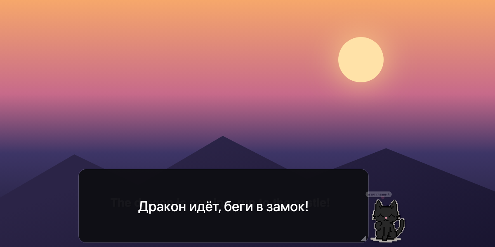

<div align="center">


# Shmotix

**Переводит субтитры прямо с экрана. Локально, офлайн — и с котиком.**

*Real-time on-screen subtitle translator with a pixel cat. Local models, no cloud.*

[](https://github.com/hukopo/shmotix/releases)
[](https://github.com/hukopo/homebrew-tap)




</div>

## Что это

Ставишь еле заметную рамку на субтитры — игры, видео, стрима, чего угодно. Shmotix раз в полсекунды
читает текст под рамкой и **рисует перевод прямо поверх оригинала**. Рядом сидит котик: за него окно
и таскают, а ещё он играет, мяукает и засыпает, если про него забыли.

- 🔒 **Всё на устройстве.** OCR (~12 МБ) и перевод (~220 МБ) работают без сети и облаков.
- ⚡ **Быстро.** Кадр с субтитром — сотни миллисекунд на CPU; один и тот же субтитр не переводится дважды.
- 🪟 **Не мешает.** Окно невидимо для записи экрана, поэтому не читает само себя и не попадает в стримы.
- 🐈‍⬛ **Котик.** Живёт в трее и рядом с рамкой.

## Установка

```bash
brew install --cask hukopo/tap/shmotix
```

При первом запуске macOS спросит разрешение **«Запись экрана»** — включи Shmotix и перезапусти.
Обновление — `brew upgrade --cask shmotix`, разрешение при этом не слетает.

## Как пользоваться

| Действие | Что будет |
|---|---|
| Тянуть котика | двигать окно |
| Уголок ◢ | менять размер — как прямоугольник в Paint, в любую сторону |
| Клик по котику | случайный трюк: прыжок, наклон головы, умывание, «ж-ж-ж!», мурчание… |
| Зажать котика | мяукает разными фразами |
| Двойной клик | свернуть всё до котика / развернуть |
| Навести на спящего | проснётся и потянется |
| Esc | спрятать в трей |
| Котик в строке меню | показать/скрыть, котик вкл/выкл, перевод поверх субтитров или полосой, выход |

## Как устроено

```
 окно Tauri (прозрачное, поверх всех)        поток Rust, каждые 500 мс
 ┌──────────────────────────────┐ область ┌──────────────────────────────┐
 │  рамка → область захвата     │ ──────▶ │ xcap: снимок экрана, обрезка │
 │  перевод поверх субтитра  ◀──┼─ event ─│ ocrs: текст с картинки       │
 └──────────────────────────────┘         │ CTranslate2: перевод         │
              🐈‍⬛                          └──────────────────────────────┘
```

| Слой | Технология |
|---|---|
| UI | Tauri 2, один HTML без сборщика, котик — пиксели на canvas |
| Захват | `xcap` |
| OCR | `ocrs` — чистый Rust, только латиница |
| Перевод | `ct2rs` (CTranslate2) + модель Argos/OPUS-MT en→ru |

Подробности и роадмап — [SPEC.md](SPEC.md).

## Сборка из исходников

Нужны Rust, Node.js и CMake (`brew install cmake` / `winget install Kitware.CMake`).

```bash
./scripts/fetch-models.sh               # модели в ./models, один раз
npm i && npm run dev                    # запустить
cd src-tauri && cargo test --release    # проверка OCR + перевода
```

Переменные: `SHMOTIX_MODELS` — папка моделей (по умолчанию внутри бандла), `SHMOTIX_PAIR` — пара языков (`en_ru`).

<details>
<summary>Для мейнтейнера: релиз и картинки</summary>

- `scripts/release.sh` — поднять версию в `src-tauri/tauri.conf.json`, затем скрипт соберёт подписанный `.dmg`,
  создаст GitHub-релиз и обновит cask в [hukopo/homebrew-tap](https://github.com/hukopo/homebrew-tap).
  Подпись — постоянным сертификатом «Shmotix Self-Signed» из связки ключей.
- Котик живёт в `ui/index.html` (`SIT` и кадры). Иконки: `python3 scripts/make-cat.py && npx tauri icon scripts/app-icon.png`.
  Анимация для README: `node scripts/make-readme-art.js`.
</details>

<div align="center"><sub>мяу 🐾</sub></div>
